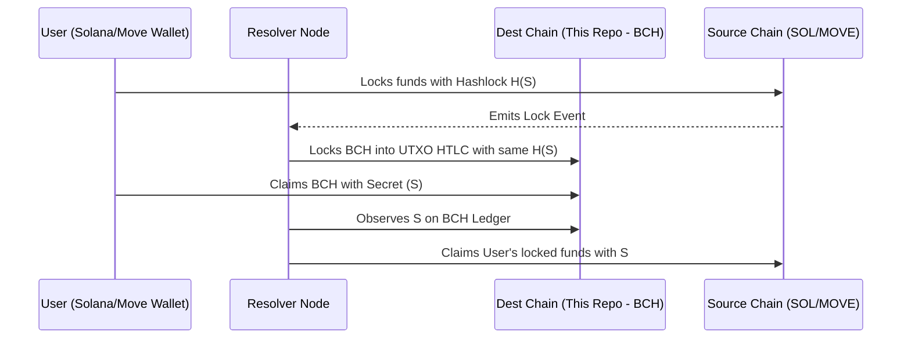

# 🔀 Intents-Swaps: Cross-Chain BCH Smart Contracts

[](../docs/reviewers-guide/01-protocol-overview.md)
[](#license)

This repository contains the core **Bitcoin Cash (BCH) smart contracts** utilized by the BCH Intents protocol for **Cross-Chain Atomic Swaps** (e.g., SOL -> BCH or MOVE -> BCH).

These contracts are written in [CashScript](https://cashscript.org/) and function as UTXO covenants, enforcing stateless cryptographic guarantees that allow users and **Decentralized Resolvers** to trade across distinct blockchain networks without a trusted intermediary.

### Related Repositories
This is part of the broader Cross-Chain architecture. It works directly in tandem with:
* **[contracts-solana](../contracts-solana)**: The Solana Target-Chain Anchor programs.
* **[contract-movement-cross-chain](../contract-movement-cross-chain)**: The Movement Target-Chain MoveVM contracts.
* **[bch-solana-relayer](../bch-solana-relayer)**: The off-chain Node.js Decentralized Resolver that fulfills the swaps.

## Core Contract: `CrossChainHTLC.cash`

The primary contract is a **Hash Time-Locked Contract (HTLC)**. 

### How It Works



1. **The Hashlock**: A Decentralized Resolver (Maker) locks BCH into this contract using a cryptographic hash `H(S)` provided by the User. 
2. **The Timelock**: The contract enforces a strict time-to-live (`T`).
3. **The Claim**: The User (Taker) can only unlock and claim the BCH if they reveal the original pre-image secret `S`. Once exposed on the BCH ledger, the Resolver reads `S` and claims the User's funds on the opposing chain.
4. **The Refund**: If the User abandons the swap and never reveals `S`, the Resolver can cleanly refund their BCH back to their wallet after `T` expires.

### Security & Review Focus
Reviewers examining this repository should focus on:
* **Delta Timelocks**: Understanding why the Relayer's timelock on BCH (`T/2`) must be strictly less than the User's timelock on the source chain (`T`).
* **CashScript Opcodes**: Ensure `REQUIRE(tx.time >= timelock)` prevents premature refunds.
* **Signature Verification**: Ensure the `maker` and `taker` signatures cannot be forged or bypassed during the `claim` and `refund` functions.

---

### Navigation
* 📖 Read the detailed **[Atomic Swaps Reviewer Guide](../docs/reviewers-guide/02-cross-chain-atomic-swaps.md)** for sequence diagrams.
* 💻 Run local tests: `npm run test`

---

## 📖  Overview

Unlike traditional centralized bridges or federated multisig wrappers (which introduce custodial risk), our cross-chain architecture relies purely on **cryptographic primitives** and **Bitcoin Script**.

### The Core Contract: `CrossChainHTLC.cash`

At the heart of this repository is an elegant, 60-line [CashScript](https://cashscript.org/) contract. It does not use mutable storage or central operators. Instead, **the covenant IS the state**. 

When a user or solver locks funds, they create a deterministic P2SH address based on four constructor parameters:

```cashscript
contract CrossChainHTLC(
    bytes20 senderPkh,     // WHO locks the funds
    bytes20 recipientPkh,  // WHO can claim the funds
    bytes32 secretHash,    // SHA-256 hash of the 32-byte secret
    int timelock           // Unix timestamp expiry
)
```

### How the Magic Works (The Atomic Swap)

The atomic swap guarantees that either **both parties get the funds on their respective chains**, or **both parties get a refund**. It works via a shared cryptographic secret.

#### 1. The `claim` Function (The Happy Path)
When the solver fulfills the user's intent on the destination chain (e.g., Solana), the user must reveal the original 32-byte `secret` to claim their funds there.

Once that `secret` is revealed on Solana, the solver takes that exact same secret and passes it to the BCH covenant:

```cashscript
function claim(pubkey recipientPk, sig recipientSig, bytes32 secret) {
    require(hash160(recipientPk) == recipientPkh); // Verify Identity
    require(checkSig(recipientSig, recipientPk));  // Verify Signature
    require(sha256(secret) == secretHash);         // Verify Secret!
}
```
Because `sha256(secret) == secretHash`, the contract unlocks, and the solver receives the BCH. **No central bridge required.**

#### 2. The `refund` Function (The Safety Net)
If the solver never fulfills the intent on the destination chain, the user simply waits. Once the `timelock` (Unix timestamp) passes, the user can call `refund`:

```cashscript
function refund(pubkey senderPk, sig senderSig) {
    require(hash160(senderPk) == senderPkh);
    require(checkSig(senderSig, senderPk));
    require(tx.time >= timelock);                  // Introspection Opcode!
}
```
Using the BCH native introspection opcode `tx.time` (verifying `OP_TXLOCKTIME`), the contract mathematically guarantees the user gets their money back.

---

## 🛠️ Getting Started & Testing

This repository includes a comprehensive test suite that simulates the entire lifecycle of an HTLC. It's the perfect place for developers to understand the mechanics.

### Prerequisites
- Node.js (v18+)
- Basic understanding of [CashScript](https://cashscript.org/) concepts

### Installation

```bash
npm install
```

### Running the Test Suite

We use `cashscript` alongside `ElectrumNetworkProvider` to run tests directly against the **BCH Chipnet (Testnet)**. 

```bash
npm test
```

The test script (`test/CrossChainHTLC.test.ts`) runs through 5 distinct validations:
1. **Compilation & Instantiation**: Compiles the `.cash` file and generates a deterministic address.
2. **Secret/Hash Verification**: Ensures SHA-256 alignment between the raw 32-byte secret and the hashed lock.
3. **Timelock Logic**: Simulates before/after expiry scenarios to validate the `tx.time` constraints.
4. **HTLC Lifecycle Simulation**: A step-by-step console Walkthrough of the atomic swap process.
5. **HTLC Uniqueness**: Proves that changing the `secret` or any parameter creates a distinct, parallel covenant address.

---

## 🧠 technical achievements

1. **State on a Stateless Chain**: We map complex cross-chain state machines onto BCH's UTXO model by baking the state into the covenant's constructor parameters.
2. **True Decentralization**: There is no "admin key" or "relayer multisig". The Decentralized Resolvers in our ecosystem only observe and pass data; they cannot steal funds because they cannot fake the SHA-256 secret.
3. **Future-Proofing (2026 STARK Upgrades)**: Connect this implementation to the upcoming 2026 BCH VM upgrades. While we do this securely today with HTLCs, the upcoming `OP_BEGIN/OP_UNTIL` and **Triton VM STARK verifiers** will allow us to compress this logic and do fully asynchronous, zero-knowledge verification directly on-chain.

---

## 📜 License

**Copyright (c) 2026 Intents-Swaps. All Rights Reserved.**
This software and associated documentation files are proprietary and confidential. No part of this repository may be copied, reproduced, distributed, or modified without explicit written permission.

*Part of the Intents Swap Protocol Ecosystem — Bringing Intent-based DeFi to Bitcoin Cash.*
